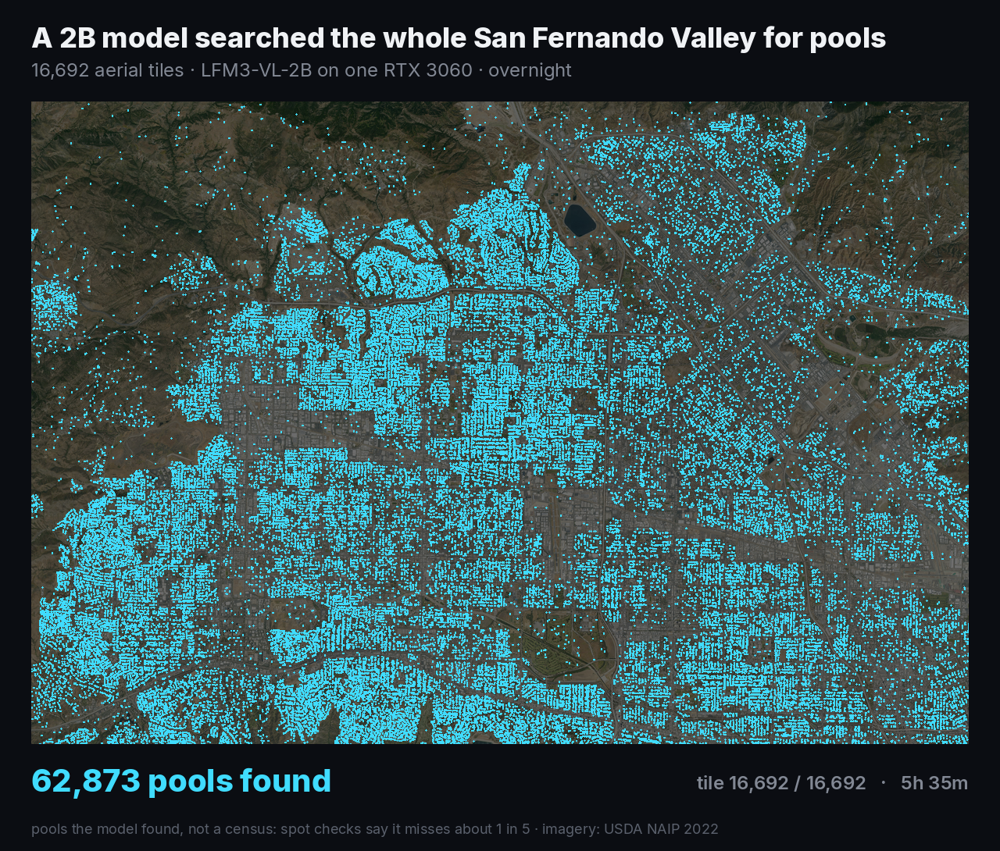
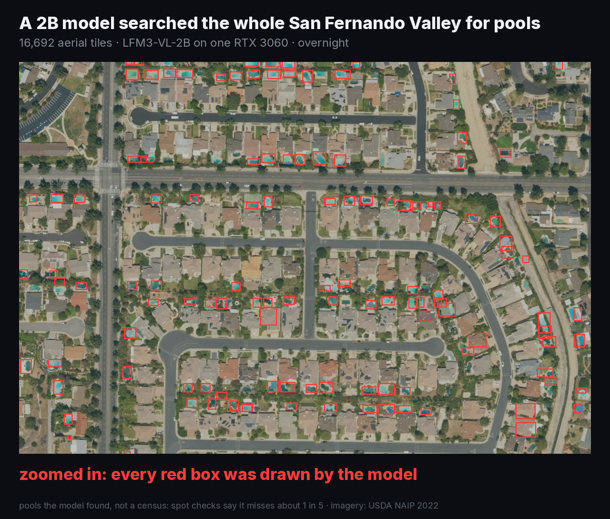

# aerial-scan

A 2B vision model looks at every rooftop in a city and draws a box around every thing you ask for.

The first run: [LFM3-VL-2B](https://huggingface.co/LiquidAI/LFM3-VL-2B) searched the whole San Fernando Valley (about 615 km², 16,692 aerial tiles) for swimming pools. One RTX 3060, 5h 35m, thinking on, no finetune. It found 62,873 pools.




Be honest with the result: it's "pools the model found", not a census. In spot checks it misses about 1 in 5 and boxes a roof now and then.

`out/pools.json` has every box from that run, in tile coordinates and in UTM metres.

## how it works

1. `fetch.py` downloads free [NAIP](https://planetarycomputer.microsoft.com/dataset/naip) aerial photos (US only, 60 cm per pixel) from Microsoft Planetary Computer. It cuts your area into a 192 m grid, 320 px per tile, and builds a small mosaic for the map.
2. `scan.py` sends every tile (upscaled to 640 px) to the model with one prompt: "Detect every {TARGET} in this aerial photo. Output only a JSON list of bounding boxes". LFM3-VL can ground objects, so it answers with boxes. It's resume-safe and runs 64 requests at once.
3. `clean.py` parses the answers (leniently, a 2B model sometimes breaks the JSON), drops boxes that are too big to be the target, and merges objects cut in half by tile edges. Tiles don't overlap: boxes near an edge are moved to map coordinates and merged with the neighbour tile's box if they touch.
4. `render.py` makes the video: the map lights up as tiles get scanned, a dot per find, then a zoom into one block with the model's boxes.

Tile size matters. With 384 m tiles the boxes landed on roofs. At 192 m they sit on the pools.

## run it

You need a llama.cpp build with LFM3 support and the GGUF from [LiquidAI/LFM3-VL-2B-GGUF](https://huggingface.co/LiquidAI/LFM3-VL-2B-GGUF).

```bash
llama-server -m LFM3-VL-2B-Q8_0.gguf --mmproj mmproj-LFM3-VL-2B-F16.gguf -ngl 99 -fa on --jinja \
  -np 64 -c 1048576 -ctk q8_0 -ctv q8_0 -b 2048 -ub 1024 \
  --temp 0.1 --top-p 1.0 --top-k 50 --min-p 0.0 --repeat-penalty 1.1 --reasoning on --no-reasoning-preserve --port 8080
```

That's 64 slots of 16K, it fits a 12 GB card. Use fewer slots on smaller cards and set `PAR` to match.

```bash
pip install rasterio pillow numpy requests

BBOX=-118.67,34.15,-118.35,34.33 python3 fetch.py > fetch.log   # lon/lat box, any US area
TARGET="swimming pool" python3 scan.py scan.jsonl               # can run while fetch.py is still going
python3 clean.py                                                # -> pools.json
# render needs ffmpeg and Inter fonts (Inter-Regular/SemiBold/ExtraBold.ttf) in fonts/
TITLE="..." NOUN="pools" ZOOM_TILE=39,62 RUN_MIN=335 python3 render.py   # -> out/preview.mp4
```

### other targets

Change `TARGET` to whatever you're hunting: "solar panel", "tennis court", "parking lot", "trampoline". Then:

1. Test it on ~20 tiles first (`python3 scan.py test.jsonl 20`) and look at the boxes yourself. Some things are too small at 60 cm per pixel.
2. Set `MAX_BOX_M` in `clean.py` to the biggest real size of your target in metres (default 67, for pools).
3. Rename the output: `clean.py` writes `pools.json` either way.

Server and model are set with `LLM_URL` (default `http://127.0.0.1:8080`) and `MODEL`.

## notes

Imagery: USDA NAIP, public domain. The grid uses UTM zone 11 (`EPSG:26911`), so for areas in other UTM zones change the CRS in `fetch.py`.
